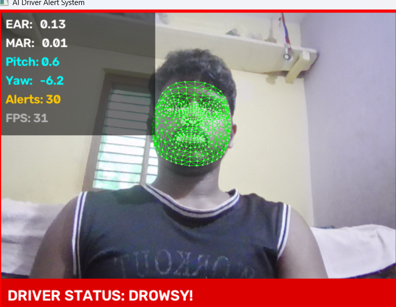
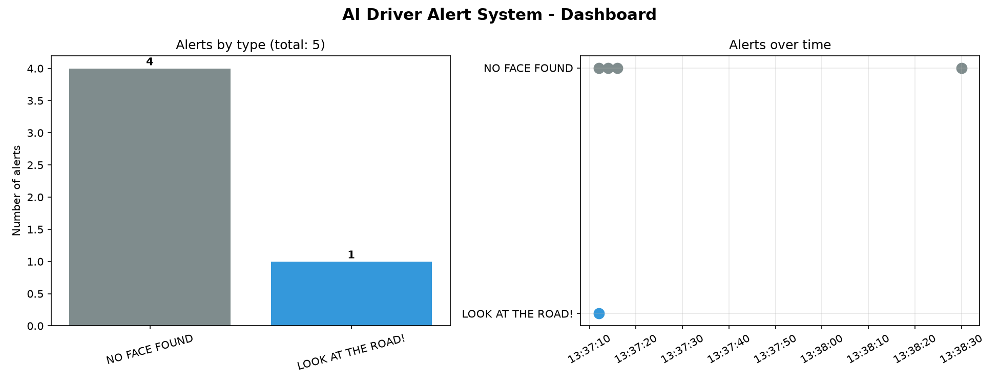

# AI Driver Alert System

A real-time driver drowsiness and distraction detector built with Python, OpenCV and MediaPipe. It uses a webcam to track facial landmarks and raises an alarm when the driver looks unsafe.

## Features

- Live face mesh tracking (468 landmarks)
- **Drowsiness detection** using Eye Aspect Ratio (EAR)
- **Yawn detection** using Mouth Aspect Ratio (MAR)
- **Head pose estimation** (pitch and yaw) to detect looking away or nodding
- 5-second **auto-calibration** to adapt to each person's face
- Audio alarm and on-screen status bar
- Alert logging to CSV with timestamps
- Dashboard with charts of alerts by type and over time
- Built-in demo recorder

## How it works

| Signal | Meaning | Alert |
|--------|---------|-------|
| EAR below the calibrated threshold for about 20 frames | Eyes closed | DROWSY! |
| MAR above 0.5 for about 15 frames | Yawning | YAWNING! |
| Yaw above 25 or pitch above 20 degrees for about 20 frames | Looking away | LOOK AT THE ROAD! |
| No face detected | Driver not visible | NO FACE FOUND |

## Tech stack

Python 3.11, OpenCV, MediaPipe 0.10.14, NumPy, Pandas, Matplotlib

## Setup (Windows)

```
py -3.11 -m venv venv
venv\Scripts\activate
pip install -r requirements.txt
```

## Run

```
python step8.py
```

Keys: **ESC** quit, **R** start/stop recording, **M** mesh on/off.

To view the alert dashboard:

```
python dashboard.py
```

## Screenshots




## Limitations

- Works best with good lighting and the camera facing the driver
- Thresholds are tuned for a webcam and may need adjusting
- Not a certified safety device. This is a learning project

## Author

Pavan Naik